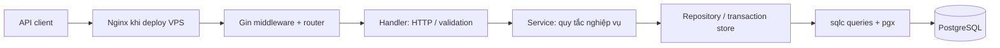
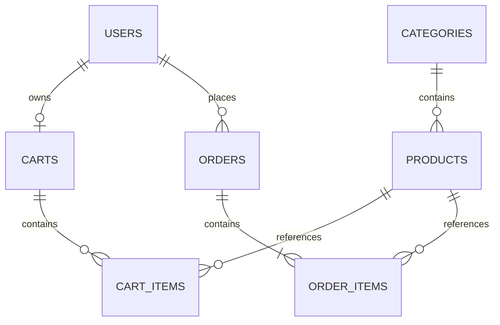

# Kiến trúc MVP

## Phạm vi

Một process Go, một PostgreSQL, một kho, VND, COD. Chưa có service độc lập hay Redis. Một SKU ứng với một cấu hình cụ thể, ví dụ laptop 16GB/512GB. Brand/model/specifications đáp ứng catalog điện tử; chưa có biến thể tổng quát, album ảnh hoặc upload ảnh.

## Luồng request

Trong local, client kết nối thẳng Gin. `main` đọc config một lần, mở pool, inject dependency, nhận signal, drain HTTP rồi đóng pool. Service dùng `context.Context`, không phụ thuộc Gin. `internal/app` là composition root. Catalog repository dùng contract nhỏ do sqlc đã đáp ứng, tránh bọc lại từng hàm SQL không thêm giá trị.

## ERD

Users giữ schema đang học (identity ID nội bộ + UUID công khai). Catalog/order dùng UUID để thống nhất public API. Không đổi ID đang dùng chỉ để theo bản thiết kế ban đầu. Index phục vụ unique lookup, category lookup, giá, brand, lịch sử đơn và trạng thái. Chưa khẳng định search ILIKE có index tăng tốc; đo query trước khi tối ưu.

## Checkout và concurrency

1. Transaction gọi `EnsureCart`: upsert lấy row lock trên cart của user. Mọi sửa giỏ/checkout dùng cùng khóa.
2. Tìm order theo `(user_id, idempotency_key)` trước khi đọc giỏ. Cùng input trả order cũ.
3. Đọc item theo UUID tăng dần; khóa từng product bằng FOR UPDATE.
4. Kiểm tra active/stock, lấy giá hiện tại và UPDATE có điều kiện stock >= quantity.
5. Tạo order + snapshot tên/SKU/giá, xóa cart items, commit.

Nếu sản phẩm thứ hai thiếu kho, rollback hoàn tác cả việc trừ sản phẩm thứ nhất. Không dùng Go mutex để bảo vệ stock: database row locks vẫn đúng nếu có nhiều process API.

Cancel khóa order trước, chỉ hoàn kho từ `placed`, xử lý product cùng thứ tự và chuyển `cancelled` trong transaction. Admin chuyển trạng thái cũng khóa order; cạnh tranh cancel/processing chỉ một đường hợp lệ thắng.

## Auth và log

JWT HS256 chỉ chứa claim xác thực cần thiết, không chứa password/PII. Parser giới hạn thuật toán và kiểm tra expiration/issuer/audience. Middleware đọc user hiện tại để áp dụng role và trạng thái mới nhất. Không cần AES bọc payload JWT vì không lưu thông tin bí mật trong payload; HTTPS bảo vệ đường truyền.

API key là bootstrap credential tùy chọn trên request quản trị, không phải token của khách hàng. Log chỉ có request ID/method/route/status/duration; không sao chép header hay body. Lỗi database được ánh xạ sang lỗi API và không trả SQL/constraint ra ngoài.

## Giới hạn vận hành

Rate limiter in-memory theo IP chỉ phù hợp một instance. Không tin X-Forwarded-For nếu chưa khai báo proxy đáng tin. Offset pagination và count/list riêng phù hợp dữ liệu portfolio, không đảm bảo snapshot hoàn toàn cố định khi có concurrent inserts. Không retry transaction tự động; nếu có deadlock/connection failure, caller phải retry với cùng idempotency key. PostgreSQL là nguồn quyết định price/stock/order.

Catalog PUT dùng optimistic version để tránh ghi đè stock bằng form cũ sau checkout/cancel. Customer cart không được xem là đã giữ hàng. Lịch sử đơn dùng snapshot và sản phẩm chỉ bị deactivated.
